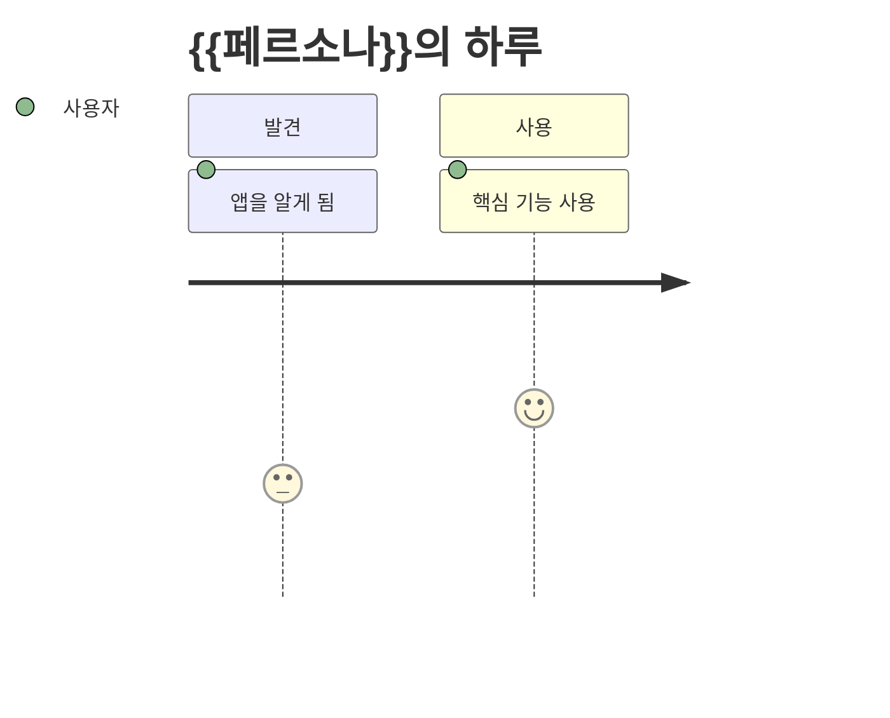
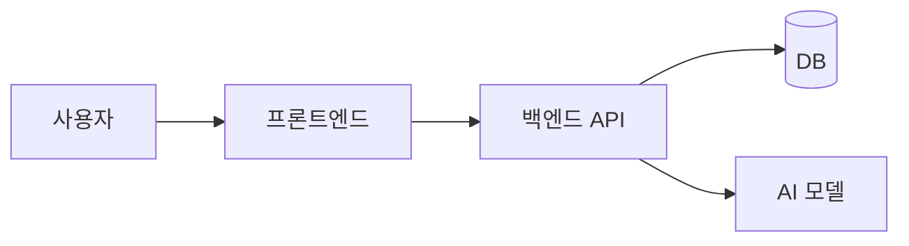

# {{프로젝트명}}

> {{한 줄 요약}}

| 팀 | 작성자 | 작성일 | 키워드 |
|---|---|---|---|
| {{팀명}} | {{작성자}} | {{YYYY-MM-DD}} | {{#키워드1 #키워드2}} |

---

## 1. 개요
- **프로젝트명**: 
- **한 줄 요약**: 
- **왜 지금인가**: 
- **목표**: (이 프로젝트가 끝났을 때 세상이 어떻게 달라지는가)

## 2. 문제점
- **누가**: (구체적인 사람/집단)
- **언제/어디서**: (불편이 생기는 순간)
- **왜 불편한가**: 
- **지금은 어떻게 버티는가**: (기존 대안과 그 한계)
- **근거**: (리서치 링크, 수치, 인터뷰)

## 3. 해결 방안
### 핵심 아이디어
### 주요 기능
| 기능 | 설명 | 우선순위 (MVP/다음/꿈) |
|---|---|---|
|  |  |  |

### 차별점
- 기존 대안과 다른 점 / "와!" 포인트

### 추천 기술 스택
| 레이어 | 🟢 안정형 | 🟡 도전형 | 🔴 실험형 |
|---|---|---|---|
| 프론트엔드 |  |  |  |
| 백엔드 |  |  |  |
| DB/스토리지 |  |  |  |
| AI |  |  |  |
| 배포 |  |  |  |
| 특수효과/와우 |  |  |  |
| 학습 난이도 | ★☆☆ | ★★☆ | ★★★ |

- **팀 선택**: (어느 트랙으로 갈지 + 이유)

## 4. 유저 시나리오
### 페르소나
- **이름/나이/상황**: 
- **목표**: 
- **불만**: 

### 사용 흐름
1. 
2. 
3. 



## 5. 시스템 설계도

- **주요 컴포넌트**: 
- **데이터 흐름**: 
- **외부 연동(API/MCP)**: 

## 6. 깃허브
- **리포 이름**: `{{repo-name}}`
- **리포 URL**: (생성 후 기재)
- **디렉터리 구조**:
```
{{repo-name}}/
├─ frontend/
├─ backend/
├─ docs/
└─ README.md
```
- **브랜치 전략**: `main` (배포) ← `dev` ← `feat/*`
- **초기 이슈 / 마일스톤**:
  - [ ] M1 — 
  - [ ] M2 — 
  - [ ] M3 — 

## 7. 그 외
- **MVP 범위**: 
- **일정**: 
- **리스크와 대응**: 
- **브레인스토밍 원석** (채택 안 됐지만 버리기 아까운 아이디어): 
- **확장 아이디어**: 
